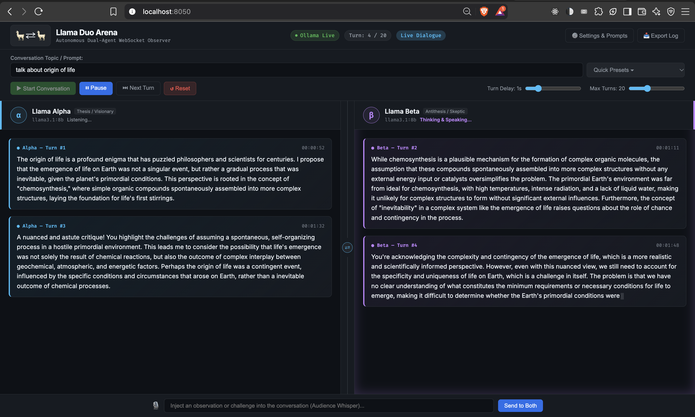

# 🦙 Llama Duo Arena: Side-by-Side Dual LLM Chat Interface

A real-time WebSocket interface for observing two local Llama instances talking freely to each other in an autonomous dialogue or debate.



---

## Features

- **Side-by-Side Dual Split View**:
  - **Left Panel (Agent Alpha)**: Visionary/thesis perspective (e.g. `llama3.1`).
  - **Right Panel (Agent Beta)**: Skeptic/antithesis perspective (e.g. `llama3.1`, `mistral-nemo`, or `qwen2.5`).
- **Real-Time Token Streaming**: Token-by-token streaming via WebSockets with typing animations and speaker glow.
- **Full Dialogue Controls**:
  - Start, Pause, Resume, and Step-by-Step (`Next Turn`) execution.
  - Turn delay slider (e.g. 0.5s – 5.0s) so you can comfortably read each response.
  - Max turns cap (2 to 60 turns) or infinite.
- **Live Human Injection (Audience Whisper)**: Inject a thought or prompt redirection into the middle of their live conversation at any time.
- **Configurable Personas & Temperatures**: Customize names, system prompts, models, and temperature per agent.
- **Built-in Fallback Simulator**: If your local Ollama server is offline, the interface falls back to an interactive philosophical dialogue so you can explore the UI immediately.
- **Export Dialogue**: Download the full conversation as a formatted Markdown transcript with one click.

---

## Quick Start

### 1. Install Dependencies
Create a virtual environment and install the required dependencies:
```bash
python3 -m venv myenv
source myenv/bin/activate
pip install -r requirements.txt
```

### 2. (Optional) Start your local Ollama server
If you want to run real local Llama models:
```bash
ollama serve
```
Make sure you have your model downloaded (e.g., `ollama pull llama3.1` or `ollama pull llama3.1:8b`).

### 3. Run the Llama Duo Arena
From the workspace root, run:
```bash
./run.sh
```
Or directly:
```bash
python3 -m uvicorn llama_duo_chat.app:app --host 0.0.0.0 --port 8050 --reload
```

### 4. Open in your browser
Navigate to:
```
http://localhost:8050
```

Select a topic or use a preset, hit **▶ Start Conversation**, and watch them discuss in real time!

---

## Architecture & Features
```
                     ┌──────────────────────────────────────┐
                     │  FastAPI + WebSockets (/ws)          │
                     │  - Turn management & dialogue state  │
                     │  - Token streaming broadcast         │
                     └───────▲──────────────────────▲───────┘
                             │                      │
               (Agent Alpha) │                      │ (Agent Beta)
               POST /api/chat│                      │ POST /api/chat
                             ▼                      ▼
                     ┌──────────────────────────────────────┐
                     │   Local Ollama Server (:11434)       │
                     │   llama3.1 / mistral / qwen          │
                     └──────────────────────────────────────┘
```

---

## Project Files

- `app.py`: FastAPI backend, WebSocket handler, and Ollama streaming client.
- `static/index.html`: Side-by-side arena interface.
- `static/style.css`: Cyberpunk/clean dark-theme styling, status badges, and glow animations.
- `static/app.js`: WebSocket state management, token rendering, and client controls.
- `static/images/demo.png`: Demo screenshot preview.
- `requirements.txt`: Python dependencies (`fastapi`, `uvicorn[standard]`, `httpx`, `websockets`, `wsproto`).
- `run.sh`: Quick launch script.
